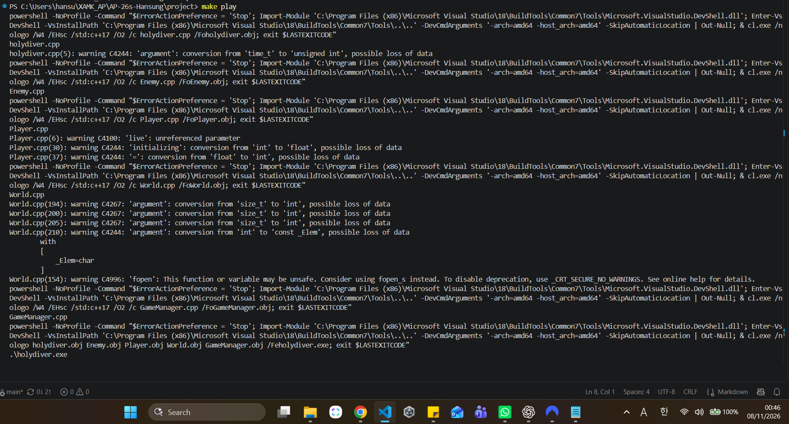

# Holy Diver _Hansung Jang (08.11.2026.)

Holy Diver is a Windows console game written in C++17.

## Build and run

Install GNU Make and Visual Studio Build Tools with the MSVC C++ compiler. In PowerShell, open the `project` directory containing the `Makefile` and map files, then run:

```powershell
make
.\holydiver.exe
```

The Makefile compiles the five C++ source files into `.obj` files and links them into `holydiver.exe`. Run `make play` to build and launch the game in one step.

At the map prompt, press Enter to load `Map2.txt`, or enter the path to another map file.

If Visual Studio Build Tools is installed in a different location from the Makefile default, pass the actual `Common7\Tools` directory to Make:

```powershell
make "VSDEV_TOOLS=C:\path\to\BuildTools\Common7\Tools"
```



## Source structure

| Header | Responsibility |
| --- | --- |
| `Enemy.hpp` | Declares the base `Enemy` class and the moving and stationary enemy types. |
| `Player.hpp` | Declares `Player`, which tracks health, oxygen, position, available lights, and survival status. |
| `World.hpp` | Declares `World`, which loads and renders the map and handles movement, enemy collisions, and lighting. |
| `GameManager.hpp` | Declares `ControlManager`, which handles input, runs the game loop, and manages restart and exit. |

The entry point in `holydiver.cpp` creates a `ControlManager` and calls its `run()` method.

## AI use disclosure

AI was used during development to:

- Help write the Makefile rules for compiling the source files and linking the executable.
- Learn how to separate class declarations into `.hpp` files and member function definitions into `.cpp` files.
- Review the code and check for missing functionality.
- Consult examples for using `std::unique_ptr<Enemy>` in `enemyContainer` and using type casts to handle movable enemies in `World.cpp`.
